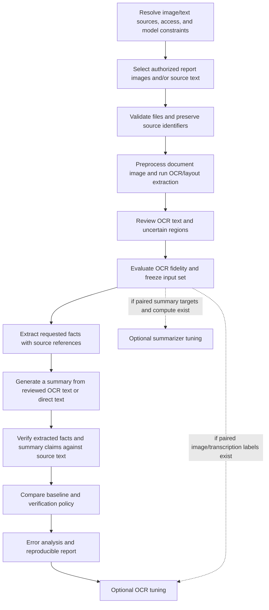

# Implementation Workflow: Report Images to Verified Summaries

## Research Goal

Build a research prototype that accepts images of medical reports, extracts their text with OCR, and produces concise summaries and, where useful, source-linked structured facts. Evaluate both OCR fidelity and whether source-evidence verification reduces unsupported or contradictory outputs without losing clinically important information. A direct-text input path remains available for machine-readable notes and controlled comparisons.

The primary comparison is between a fixed summarizer's draft and that same draft after a pre-specified verification policy. The project does not claim to eliminate hallucinations or establish clinical safety. It is not for patient care or clinical decision-making.

## Scope

- The primary planned input is an image of a medical document (for example, a scanned or photographed report). OCR and document-layout handling are in scope; interpreting diagnostic medical imagery such as X-rays, CT, or MRI is not.
- A direct-text path supports machine-readable notes and text-only baselines. MIMIC-IV-Note contains note text, not report images, and is an optional, separately governed text source. Do not describe it as the image-OCR dataset or combine MIMIC-III records into the project dataset.
- Image upload, OCR, summarization, and a user interface are planned capabilities, not implemented features in the current scaffold. Do not claim that the repository can currently process reports end to end.
- Use only synthetic, public, or explicitly authorized report images. Medical report images and OCR transcripts can contain sensitive health information; keep raw, intermediate, and generated note-level files local and follow source-specific access and sharing rules.
- ClinicalT5 is a candidate baseline, subject to checkpoint access, license/terms, tokenizer and context compatibility, and a provenance check. If the constraint excludes MIMIC-III pretraining as well as MIMIC-III project data, confirm that before adopting a checkpoint.
- A reference-summary dataset is required for supervised fine-tuning and reference-based metrics. Do not assume MIMIC-IV-Note alone supplies paired targets. Verify the exact candidate resource, task definition, schema, access terms, and available patient/admission identifiers before choosing it.
- Keep restricted notes, derived note-level data, model weights, credentials, and note-level predictions out of Git unless the applicable terms explicitly allow a particular artifact to be shared.

## End-to-End Flow

## Phase 0: Resolve Feasibility

Make a short decision record before downloading data or building around a particular checkpoint.

1. **Task and target:** Specify report types and image formats, summary type, any structured fields to extract, and whether the goal is inference-only evaluation, supervised fine-tuning, or both. Define behavior for absent or ambiguous fields; do not infer them. Keep medical-image diagnosis outside scope.
2. **Image/text sources:** Identify exact image and transcription sources. Confirm that image/transcription pairs exist before promising OCR training. Treat MIMIC-IV-Note as text-only; verify input/reference-summary pairing separately before supervised summarization or reference-based evaluation.
3. **Data rules:** Confirm credentialing, training, data-use agreements, storage location, and restrictions on images, OCR text, derived data, and model artifacts. Decide whether any external OCR service is permitted; default to local processing.
4. **Models:** Confirm the OCR engine's license, language support, layout behavior, and hardware needs. Separately confirm access to the selected ClinicalT5 checkpoint, tokenizer, context limit, license/terms, and pretraining provenance.
5. **Compute:** Record available hardware and decide what can be completed on CPU before planning OCR or summarizer training.

**Deliverable:** A brief `research_decisions.md` (or equivalent) recording choices, unresolved questions, and links to authoritative dataset/model documentation. Do not put credentials or restricted data in this record.

**Gate:** If paired references are unavailable, do not promise supervised fine-tuning or ROUGE/BERTScore against references. Revise the experiment to match the available labels and obtain approval for that change.

## Phase 1: Repository and Data Handling

Set up a small Python package, tests, configuration placeholders, and an explicit local-data policy before handling restricted material. Keep document ingestion/OCR separate from summarization and verification so image-level errors can be measured independently.

- Keep source images, OCR transcripts, processed datasets, model checkpoints, local configuration, and generated note-level artifacts in ignored local paths.
- Use synthetic examples for unit tests. Never paste real notes into committed tests, notebooks, logs, screenshots, or issue reports.
- Keep access tokens out of source control and configuration examples.
- Pin and document runtime dependencies when their versions are selected; avoid installing model/training stacks before the model and hardware decisions are known.

**Deliverable:** The installable package scaffold, ignore rules, data-handling instructions, and a passing smoke test.

## Phase 2: Dataset Audit and Task Definition

Start with the smallest authorized sample that is sufficient to understand the image and text sources. Do not begin by downloading or processing the full resource.

Check and record:

- Actual file types, image dimensions, page counts, missing or empty inputs/targets, duplicates, and stable source identifiers.
- Whether the source provides a trusted transcription for each image, and whether it permits OCR evaluation or training.
- How source notes map to targets; inspect authorized examples locally and confirm that the target section is not accidentally included in the input.
- Note type, section boundaries, date/temporal fields, de-identification markers, and any inclusion/exclusion rules.
- Input and target token-length distributions using the selected checkpoint's tokenizer, once available.
- Whether a provided split exists and whether patients or admissions overlap across partitions.

Do not remove punctuation, negation terms, uncertainty markers, medication details, or section structure as generic “cleaning.” Normalize only formatting that has been shown not to change meaning. Preserve page and region order, and retain enough coordinates or page references to trace extracted text back to the source image.

**Deliverable:** A data audit report containing aggregate statistics and documented decisions, but no restricted note text.

## Phase 3: Image Ingestion and OCR Baseline

Implement a local image-ingestion boundary before adding a UI. Validate file type and size, support multi-page reports deliberately, and reject unsupported or malformed inputs with a useful error. Keep original images unchanged; any orientation correction, deskewing, denoising, or contrast adjustment must be reproducible and evaluated rather than silently applied.

- Compare suitable OCR engines on a small authorized sample; select one only after recording language, license, layout/table handling, runtime, and hardware tradeoffs.
- Preserve page order, text blocks, bounding boxes when available, and engine confidence as provenance. OCR confidence is a routing signal, not a measure of clinical correctness.
- Compare OCR output with trusted transcriptions where available using character/word error rates plus targeted review of numbers, units, medication names, negation, dates, and table structure.
- Provide a review/correction step for low-confidence or clinically consequential text before summarization. Preserve both original OCR output and reviewed text locally with their source references.
- If no image/transcription pair is available, evaluate a documented manually transcribed sample and do not claim a general OCR accuracy result.

**Deliverable:** A reproducible OCR baseline, reviewed sample, and image/text provenance record without restricted content.

## Phase 4: Extract Facts and Generate Summaries

Define a small, report-specific output schema only after selecting the report type. Candidate fields may include report date, test/procedure name, measured value, unit, and the report's stated impression; do not combine incompatible report types under an unvalidated schema.

- Extract only information explicitly present in the reviewed source text. Represent missing, unreadable, and ambiguous values distinctly rather than guessing.
- Attach a source-text span and page/region reference to each extracted field where available.
- Generate a concise narrative summary from the reviewed source text. Structured extraction can be an optional output mode; it must not be presented as a diagnosis or treatment recommendation.
- Evaluate field-level accuracy and summary quality separately, including number/unit binding, dates, negation, uncertainty, and omissions.

**Deliverable:** A documented extraction schema and baseline outputs linked to source evidence, kept in permitted local storage.

## Phase 5: Split and Preprocess

- Prefer an official split when its construction is documented and suitable. Otherwise split by patient, or by admission if that is the best supported grouping, so related examples cannot leak across partitions.
- Create and freeze the split before comparing systems. Record the seed, grouping key, exclusions, and counts. If the necessary grouping identifier is unavailable, document that leakage cannot be ruled out and limit the claims accordingly.
- Check the real tokenizer and model context limit. Compare section-aware selection or chunking with truncation on a small sample; measure what source content is retained. Never assume a 512-token limit or blindly truncate to the beginning of a note.
- Make the transformation reproducible and test it with synthetic fixtures, including empty inputs, repeated rows, long notes, negation, and uncertainty.

**Deliverable:** A repeatable split/preprocessing command and a split manifest that contains no note text or credentials.

## Phase 6: Establish a Summarization Baseline

Run the selected pretrained checkpoint on a small, fixed set of held-out examples before fine-tuning.

- Confirm the model and tokenizer load from authorized sources and inference completes.
- Fix and record decoding parameters, model revision, input handling, software versions, and random seeds where applicable.
- Inspect outputs for truncation, repetition, unsupported additions, contradictions, omissions, and changes to negation, certainty, medication, or time.
- Save predictions only in the permitted local output location. Do not commit note-level outputs.

If the checkpoint is unavailable, record the blocker and agree on a replacement model before changing the research question. Do not silently substitute a generic model and report it as ClinicalT5.

**Deliverable:** A reproducible baseline run and an initial error log.

## Phase 7: Define Evaluation Before Comparing Systems

Use the same frozen test cases and generation settings for every compared system. Decide the primary outcome and annotation protocol before inspecting final test results.

Measure complementary properties:

- **OCR fidelity:** Character/word error rates against authorized ground-truth transcripts, plus targeted error categories for numeric values, units, medications, negation, dates, and layout/reading order. Keep OCR metrics separate from summary metrics.
- **Structured extraction:** Field-level exact/normalized match and source-span support, only where trusted field labels are available; report missing and ambiguous fields separately.
- **Reference similarity:** ROUGE, and optionally BERTScore, only when valid paired references are available. These are not measures of clinical correctness.
- **Claim factuality:** Manually reviewed supported, contradicted, and insufficient-evidence claims; report rates with clear denominators.
- **Coverage and preservation:** Important-fact omissions, negation, uncertainty, medication details, and temporality, using a written rubric.
- **Operational cost:** Generation/verification time, memory where relevant, and the share of claims flagged for review.

Manually review a documented sample. Use a second reviewer and adjudication where feasible; otherwise label the annotations as researcher judgments, not clinical validation. Report uncertainty and failure cases. Avoid treating an automatic factuality score as ground truth.

**Deliverable:** A versioned evaluation protocol and annotation rubric.

## Phase 8: Build a Verifier in Shadow Mode

The first verifier should produce an evidence report without changing the draft summary.

1. Split the draft into atomic clinical claims where possible. Keep compound claims distinguishable so that one supported detail does not mask another unsupported detail.
2. Retrieve multiple relevant source spans, not just one sentence. Preserve source offsets or another stable location reference for auditability.
3. Classify each claim as:
   - **Supported:** retrieved evidence supports the same clinical meaning, including polarity, certainty, and time.
   - **Contradicted:** evidence affirmatively conflicts with the claim.
   - **Insufficient evidence:** the available evidence does not establish support or contradiction. Missing a retrieved match is not proof that a claim is false.
4. Record the claim, evidence locations, label, model/score if used, and reason for review. Evaluate the verifier against manually annotated examples, especially negation, uncertainty, medication details, and temporality.
5. Measure retrieval failures separately from classification failures. Check precision/recall or a confusion matrix on the annotated sample before setting any operating threshold.

Start with a transparent retrieval baseline (for example, BM25) and add an entailment model only if it can be run and evaluated under the access and compute constraints. Generic NLI models may misread clinical language; do not assume their labels are reliable without validation.

**Deliverable:** A verifier report containing evidence and flags, with the original summary preserved unchanged.

## Phase 9: Evaluate a Conservative Intervention

Only after shadow-mode performance is measured, evaluate a policy that acts on verifier results. Keep this separate from claim detection.

- Initially retain supported claims and flag contradicted or insufficient-evidence claims for review. Do not automatically delete every claim without a retrieved match.
- If testing automatic revision or removal, define the policy and stopping condition in advance, re-check every changed claim against the original note, and measure newly introduced errors and lost information.
- Compare the draft and post-policy output for the same examples. Report factuality and coverage together; a lower unsupported-claim rate is not an improvement if important content is simply removed.

**Deliverable:** A paired comparison and error analysis. The primary claim is whether verification reduces unsupported/contradictory claims while preserving important information, not whether it eliminates hallucinations.

## Phase 10: Optional Fine-Tuning, Demo, and Report

**Fine-tuning is conditional.** Proceed only if the selected dataset has valid paired targets, model use is permitted, the split is fixed, and a small reproducible training run fits available compute. Compare the fine-tuned model with the pretrained baseline using the same test set; keep the verification comparison paired with each model's own draft.

Build a small local demonstration with report-image selection/upload only after ingestion, OCR review, generation, and verification interfaces are stable. Do not send report images to third-party services unless the data terms and user consent explicitly permit it. Show the OCR text, uncertain regions, evidence links, and limitations rather than presenting a result as clinically approved.

The final report should document the dataset version and access constraints, selection and split, model/checkpoint provenance, preprocessing, context handling, decoding settings, verifier thresholds, annotation protocol, metrics, compute, and representative successes and failures. State limitations and that the system is a research prototype, not a clinical decision tool.

## First Milestone

1. Decide whether the first milestone uses synthetic/public sample images or an authorized report-image source; separately record any direct-text source.
2. Select representative image types and establish local-only handling and source/transcription permissions.
3. Compare OCR engines on a small sample and define a human review path for uncertain text.
4. Confirm summarization model choice, reference availability, and provenance/access requirements.
5. Install the repository scaffold and run its smoke test; then record the OCR and summary evaluation protocols before comparing systems.

These are gates, not calendar estimates. Progress depends on access approval, available paired data, and compute.