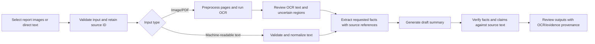
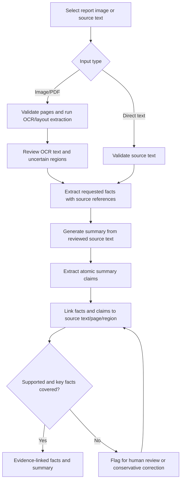
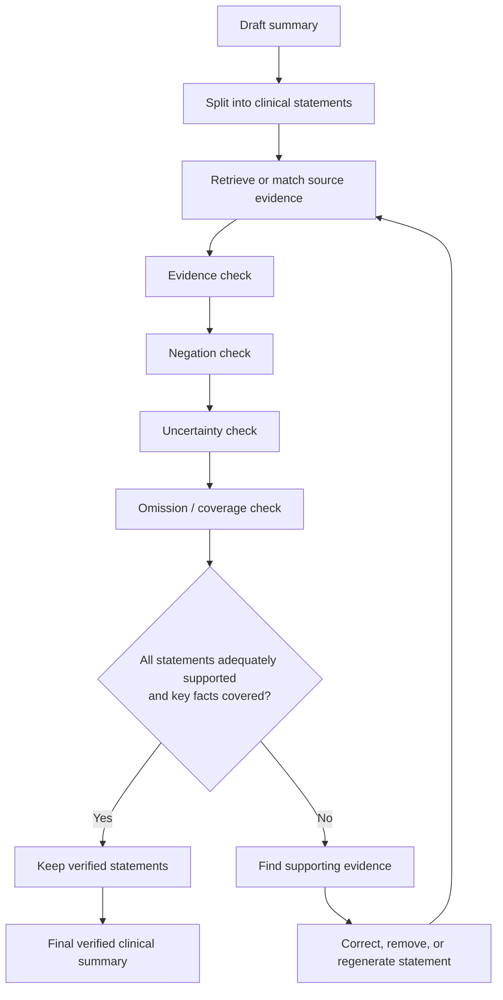
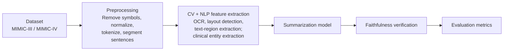

# Clinical Report OCR and Evidence-Grounded Summarization

Research prototype for extracting text from medical report images, generating concise summaries, and evaluating whether source-evidence checks reduce unsupported claims without losing important information.

**Status:** Local image upload, OCR, and editable text review are implemented as an early prototype. Summarization, structured extraction, and evidence verification are not implemented yet. This is not a clinical tool.

## Start Here

- [Implementation workflow](Implementation_Workflow.md)
- [Revised proposal slides](Clinical_Note_Summarization_Revised.pptx)
- [Original proposal PDF](Clinical%20Note%20Summarization.pdf)
- [Consolidated proposal notes](#project-background)

## Current Scope and Open Decisions

- The planned primary input is a scanned or photographed medical report. OCR and document-layout extraction are in scope; interpreting diagnostic imagery such as X-rays, CT, or MRI is not.
- A direct-text path supports machine-readable notes and text-only baselines. MIMIC-IV-Note is a text resource, not a source of report images; it is an optional, separately governed dataset for text experiments.
- The OCR prototype uses RapidOCR with its CPU ONNX Runtime backend. It is not yet evaluated on real report images; only a synthetic smoke sample has been checked. English/Chinese are the default model languages; check model support before using other languages.
- The image source and summary targets are still undecided. Do not use the unverified Kaggle download. Do not claim end-to-end summarization or clinical accuracy.
- The exact dataset and note-summary pairing are not yet selected. MIMIC-IV-Note provides notes; do not assume it alone provides the reference summaries needed for supervised training or reference-based evaluation. Verify the candidate benchmark's schema, pairing, access terms, and split identifiers first.
- ClinicalT5 is a candidate baseline, not yet a dependency. Confirm checkpoint access, tokenizer compatibility, context limits, and pretraining provenance. In particular, distinguish excluding MIMIC-III from the project's downstream data from requiring a model that was never pretrained on MIMIC-III.
- The research question is whether evidence-based verification reduces unsupported or contradictory claims while preserving clinically important content.

## Repository Layout

```text
configs/                          Experiment configuration (no credentials)
data/                             Local-only data; see data/README.md
notebooks/                        Exploratory analysis, without committed notes
scripts/                          Reproducible command-line entry points
src/clinical_note_summarization/
   data/                           Source validation and text preprocessing
   ocr/                            Image ingestion, preprocessing, OCR, and layout
   extraction/                     Source-linked clinical fact extraction
   generation/                     Model loading and summary generation
   verification/                   Claim/evidence checks and policy
   evaluation/                     Metrics and review exports
tests/                            Unit tests using synthetic examples
```

## Planned Processing Flow



OCR confidence is not clinical confidence. OCR text should be reviewed when uncertain, especially for numbers, units, dates, medications, negation, and table reading order. The verifier checks the draft against extracted source text; it cannot compensate for information OCR failed to capture.

## Local Setup

The base install has no model or dataset dependencies. To run the local OCR review app, install its optional dependencies. In PowerShell, from the repository root:

```powershell
py -m venv .venv
.\.venv\Scripts\python.exe -m pip install --upgrade pip
\.venv\Scripts\python.exe -m pip install -e ".[app,dev]"
.\.venv\Scripts\python.exe -m pytest
\.venv\Scripts\python.exe -m streamlit run scripts/ocr_app.py
```

The app accepts one PNG, JPEG, or WebP page at a time, runs OCR locally, and lets you review/edit recognized text. It does not save the uploaded image or reviewed text. On first use, RapidOCR may download its model files into the Python environment. The review output is not yet connected to a summarizer.

To inspect authorized CSV data and use notebooks, install the data-analysis tools. Add `pyarrow` only if the selected files are Parquet:

```powershell
.\.venv\Scripts\python.exe -m pip install pandas jupyterlab
# Optional for Parquet files:
.\.venv\Scripts\python.exe -m pip install pyarrow
```

### Optional Model Dependencies

Install these only after confirming dataset access, the model checkpoint, and available hardware. Install PyTorch using the command for your platform and CPU/CUDA configuration from the [official PyTorch selector](https://pytorch.org/get-started/locally/), then install the model libraries:

```powershell
.\.venv\Scripts\python.exe -m pip install transformers sentencepiece accelerate
```

For an initial TF-IDF evidence retriever and ROUGE evaluation:

```powershell
.\.venv\Scripts\python.exe -m pip install scikit-learn rouge-score
```

`bert-score` remains an optional follow-on dependency. Install packages into the local environment; model/training dependencies will be selected separately after dataset access and hardware decisions.

### OCR Dependencies

The `app` extra installs RapidOCR, ONNX Runtime, Pillow, NumPy, and Streamlit. RapidOCR is the initial local OCR choice, not a completed comparative evaluation. It currently runs with the CPU backend; assess layout, language, and table handling against authorized sample reports before relying on its output. Do not send report images to a hosted OCR service unless source terms and user consent allow it.

### Restricted Data Access

MIMIC-IV access is restricted to credentialed users who have completed the required training and signed the data-use agreement. See the [PhysioNet MIMIC-IV access page](https://physionet.org/content/mimiciv/3.1/) and its [required training](https://physionet.org/content/mimiciv/view-required-training/3.1/).

A Kaggle upload is not, by itself, permission to use restricted MIMIC-IV data. Do not use or redistribute a third-party mirror unless its provenance and authorization explicitly permit that use. PhysioNet also treats MIMIC-derived datasets and models as sensitive; follow its [sharing guidance](https://physionet.org/content/mimiciv/3.1/) and applicable agreements. If access is unavailable, use a dataset that is explicitly authorized for your use and update the project scope accordingly.

Do not put report images, OCR transcripts, MIMIC data, model weights, credentials, or note-level outputs in Git. Read [data handling notes](data/README.md) before placing any authorized files locally. MIMIC-IV-Note provides clinical note text, not report images; verify that any selected task dataset provides the paired references needed for supervised training or reference-based evaluation. Use a separately authorized image/transcription source to evaluate OCR.

## Project Background

### Consolidated project notes from the revised PPT and original PDF

> **Purpose:** A GitHub-ready text record of the two presentations, preserving the project motivation, scope, dataset details, research papers, methodology, and especially the logic represented in the flowcharts.
>
> **Source files:** `Clinical_Note_Summarization_Revised.pptx` (revised proposal) and `Clinical Note Summarization.pdf` (original presentation).
>
> **Important interpretation:** These presentations document earlier proposal stages, not the current workspace scope. The revised PPT narrows the original idea to text-only MIMIC-IV-Note + ClinicalT5 + evidence verification. The current workspace direction restores document-image OCR as the planned input path, while retaining a separate direct-text path; neither presentation establishes an image dataset or a working implementation.

---

## 1. Project overview

**Title:** Clinical Note Summarization Without Hallucination  
**Programme:** M.Tech, Information Technology, NITK  
**Submitted to:** Dr. Dinesh Naik  
**Team:** Amit Nishad (262IT002), Nikhilesh Joshi (262IT029)

### Core idea

Medical reports may arrive as scanned pages or photographs, while machine-readable clinical notes remain a useful direct-text input. OCR can make document text available to a summarizer, but recognition errors may change clinically important details. A fluent summary is not necessarily a factually faithful one, so the pipeline must preserve traceability from output claims to reviewed source text and, where possible, image page/region.

The project aims to extract and review text from report images, optionally return source-linked structured facts, generate concise summaries, and verify outputs against the extracted source. Particular attention is given to OCR errors and **negation, uncertainty, contradictions, missing important facts, medication details, numbers, units, and dates**. Extracted information must reflect the report, not add a diagnosis or treatment recommendation.

### Main principle

> Every generated clinical claim should be traceable to evidence in the source note.

### Why it matters

- Clinical narratives can be lengthy, repetitive, and difficult to scan quickly.
- A model may invent a diagnosis or medication, change an existing fact, omit an important medicine, or mishandle a negation.
- Lexical overlap with a reference summary does not establish clinical correctness.
- The desired balance is between **compression, coverage, and evidence support**.

### Hallucination terminology from the original presentation

- **Intrinsic hallucination:** Changes or contradicts information already present in the source (the slide's example: changing age 30 to age 45).
- **Extrinsic hallucination:** Adds a new, unverified fact not present in the source (the slide's example: adding a heart surgery).

### Illustrative negation failure

Source note: “Patient denies chest pain. No history of diabetes documented.”  
Unsafe summary: “Patient has chest pain and diabetes.”

The failure is not just poor wording: it reverses the clinical meaning by losing negation.

---

## 2. Research problem, objectives, and scope

### Problem statement

Clinical summarization models can produce concise, readable output, yet generated statements may be unsupported, contradictory, or incomplete relative to the source note. Existing clinical summarization models do not guarantee factual faithfulness, making hallucination a major challenge for healthcare AI.

### Objectives

1. **Build a document-text pipeline:** Ingest authorized report images, extract text with a selected OCR engine, and retain page/region provenance where available; support direct text separately.
2. **Generate concise summaries:** Use a selected summarizer (ClinicalT5 remains a candidate for compatible text inputs) without presenting OCR or NLP as diagnosis.
3. **Improve evidence-grounded factuality:** Check generated claims against reviewed source text, with attention to OCR uncertainty, negation, and clinical details.
4. **Evaluate the stages separately and together:** Measure OCR fidelity, summary coverage, and factual consistency using complementary metrics and targeted human review.

### Current workspace scope (updated from the presentation proposals)

**In scope**
- User-selected medical report images or multi-page document files, subject to an authorized source and defined supported formats.
- OCR and document-layout extraction, with confidence/provenance and a review step for uncertain text.
- A direct-text input route for machine-readable clinical notes and baselines.
- Summary generation and claim-level evidence checks against the reviewed extracted text.
- Optional report-specific structured fact extraction with page/region or text-span references; absent or ambiguous values must not be guessed.
- OCR-specific and summary-specific evaluation, including negation, uncertainty, numbers, units, and important omissions.

**Out of scope**
- Diagnosing from X-rays, CT, MRI, pathology slides, or other diagnostic imagery.
- Clinical decision-making, autonomous treatment recommendations, or claims of clinical safety.
- Uploading sensitive reports to third-party services without explicit authorization.
- Mixing MIMIC-III with MIMIC-IV in a project dataset.

The image path is document OCR, not medical-image diagnosis. The repository currently contains only a scaffold: no image uploader, OCR engine, summarizer, or end-to-end pipeline has been implemented.

---

## 3. Dataset: MIMIC-IV clinical notes

### Dataset choice

- **Source:** De-identified electronic health records from Beth Israel Deaconess Medical Center.
- **Text resource:** MIMIC-IV-Note, the companion resource providing free-text clinical notes; it is not an image OCR corpus.
- **Likely note focus:** Discharge summaries and their associated admission context.
- **Why it fits:** Clinical language includes diagnoses, treatment details, temporal information, and negation.

### Access and handling requirements stated in the revised PPT

- Complete the applicable PhysioNet credentialing and data-use training.
- Use de-identified text and do not attempt re-identification.
- Document note selection, exclusions, train/validation/test split, and preprocessing.
- Use MIMIC-IV-Note only for a direct-text path or text baseline. Do not use it to claim image-OCR evaluation or training.
- Choose a distinct, authorized image/transcription source before developing OCR metrics or tuning.
- Verify access conditions and the exact schema for the selected MIMIC-IV-Note version before data preparation.

### Illustrative schema from the revised PPT

The values below are examples from the slide, **not real patient records**. Exact fields depend on the selected table and version.

| Field | Example shown | Purpose |
|---|---|---|
| `subject_id` | `10001234` | De-identified patient key |
| `hadm_id` | `20004567` | Hospital admission key |
| `note_id` | `NOTE-0001` | Unique note identifier |
| `note_type` | Discharge summary | Select relevant note type |
| `charttime` | `2150-04-12 10:30` | Note timestamp |
| `text` | “Patient admitted with…” | Source clinical narrative |

### Example source paths

- **Image path:** Report page image -> OCR text plus page/region provenance -> reviewed source text -> summary.
- **Direct-text path:** Machine-readable clinical note -> validated source text -> summary.
- **OCR target:** Trusted transcription paired with the report image, where such labels are available.
- **Summary target:** Reference summary paired with the source text, where valid targets are available.

### Data-splitting warning

Keep patient/admission-level splits grouped to reduce leakage. Notes from the same patient or admission should not inadvertently leak across training and evaluation splits.

### Dataset discrepancy between the files

- **Original PDF:** Lists “MIMIC-III / MIMIC-IV” and describes ICU records, patient history, diagnoses, and medication.
- **Revised PPT:** Narrows the project to **MIMIC-IV only**, with note text supplied through **MIMIC-IV-Note**. It explicitly says not to mix MIMIC-III and MIMIC-IV.

For the current proposal, follow the revised PPT.

---

## 4. End-to-end workflow: the revised methodology

The updated workspace flow begins with image or direct-text input, then joins at summary generation. OCR evaluation is a separate gate before clinical summarization.



### Stage-by-stage meaning

1. **Select notes**
   - Retrieve relevant clinical notes from MIMIC-IV-Note.
   - Focus on discharge summaries for the proposed task.

2. **Prepare data**
   - Clean the text and select relevant sections.
   - Tokenize the text and create train/validation/test splits.
   - Record selection and preprocessing decisions.

3. **Generate a draft**
   - Use ClinicalT5 as the baseline summarization model.
   - Map the source note to a draft summary.

4. **Extract claims**
   - Divide the draft summary into individual clinical statements or claims.
   - Identify the key clinical facts asserted by each statement.

5. **Verify against source evidence**
   - Match each claim to one or more supporting source spans.
   - Check whether the source supports or contradicts the claim.

6. **Branch on support**
   - **Supported:** retain the claim.
   - **Unsupported:** revise or remove the claim.

7. **Correction loop**
   - Find supporting evidence in the original note.
   - Correct or regenerate the statement using that evidence.
   - Re-verify the revised statement before accepting it.

8. **Produce the final summary**
   - Concise.
   - Evidence-linked.
   - Negation-aware.
   - Uncertainty-preserving.

**Important:** The flowchart describes a proposed workflow, not a completed implementation. The slides do not specify the exact claim extractor, evidence-matching algorithm, correction model, thresholds, or stopping condition for the loop. These remain implementation decisions.

---

## 5. Expanded verification logic from the original PDF

The original PDF makes the verification stage more explicit by naming four checks. These checks can be incorporated after OCR, against reviewed extracted text and source locations.

### Statement-level verification checks

| Check | Question to ask | Example of a failure to detect |
|---|---|---|
| Evidence check | Is the statement supported by the source? | Adding a diagnosis not mentioned in the note |
| Negation check | Are “no,” “not,” and “denies” handled correctly? | Turning “no diabetes” into “diabetes” |
| Uncertainty check | Are “may,” “possible,” and “likely” preserved? | Turning a possible condition into a confirmed diagnosis |
| Omission check | Are important clinical facts missing? | Leaving out a clinically important medication |

### Verification and correction loop



### How to interpret the loop

- The unit of checking is an individual **clinical statement**, not only the summary as a whole.
- A statement should be retained only when the evidence supports it and its clinical meaning is preserved.
- Unsupported claims should be corrected or removed; the corrected version must be checked again.
- The omission check is complementary to hallucination detection: a summary may contain no invented facts and still be incomplete.
- “All statements supported” is not alone enough if clinically important facts have been omitted. The coverage check therefore matters separately.

The original PDF's novelty slide also proposes a table-like representation of extracted facts:

| Clinical fact | Source sentence | Location |
|---|---|---|
| Diabetes | “Patient has a history of diabetes.” | Page 2, Line 5 (illustrative slide example) |

This illustrates the intended evidence trace: a fact should link to the sentence and source location. For OCR input, retain page and bounding-box references where the engine provides them; for machine-readable notes, use note offsets or section boundaries.

---

## 6. Earlier pipeline in the original PDF — and what changed

The original PDF shows this broad pipeline:



### Original pipeline components

- **Dataset:** MIMIC-III / MIMIC-IV; patient history, diagnosis, medication, ICU records.
- **Preprocessing:** Remove symbols, normalize text, tokenize, segment sentences; OCR for scanned documents.
- **CV tasks:** OCR, layout detection, image enhancement, and text-region extraction.
- **NLP tasks:** Clinical entity extraction and context understanding.
- **Summarization model:** Generate a summary from extracted/preprocessed content.
- **Faithfulness verification:** Check generated content against the source.
- **Evaluation metrics:** Assess the output.

### How this historical pipeline relates to the current direction

The revised PPT removes the CV/OCR stage and selects MIMIC-IV-Note text only. The current workspace direction deliberately restores document-image OCR as a planned front end. The original flow is useful project history, but neither presentation specifies the authorized image source, OCR engine, or implementation details.

---

## 7. Literature review: papers listed in the revised PPT

The revised presentation identifies ten relevant papers/resources. The descriptions below preserve the roles assigned to them in the slides. Some entries are not fully bibliographic; verify exact author lists, titles, venues, and links before using them in a formal report.

### Model and dataset foundations

#### 1. ClinicalT5: A Generative Language Model for Clinical Text
- **Authors/year/venue shown:** Lu, Q., Dou, D., and Nguyen, T. (2022), Findings of EMNLP.
- **Role in the project:** Introduces a T5 model pretrained on clinical text.
- **Relevance:** Foundation for the proposed ClinicalT5 generation baseline.
- **How it informs the design:** Use a clinical-domain-adapted model rather than assuming a generic summarizer will behave adequately on clinical language.

#### 2. MIMIC-IV, a Freely Accessible Electronic Health Record Dataset
- **Authors/year/venue shown:** Johnson, A. E. W., et al. (2023), *Scientific Data*.
- **Role in the project:** Primary dataset description; documents EHR data, clinical measurements, and de-identified records.
- **Relevance:** Dataset provenance and understanding the broader MIMIC-IV resource.
- **Note:** The revised PPT states that free-text notes are accessed through the companion MIMIC-IV-Note resource.

#### 3. A Dataset and Benchmark for Hospital Course Summarization with Adapted Large Language Models
- **Year shown:** 2025; the slide does not provide a full author/venue citation.
- **Role in the project:** Introduces MIMIC-IV-BHC and evaluates hospital-course summaries from clinical notes.
- **Relevance:** A task-specific benchmark/resource for clinical hospital-course summarization.
- **Citation status:** Complete the bibliographic details before formal citation.

#### 4. Clinical-T5: Large Language Models Built Using MIMIC Clinical Text
- **Year/resource shown:** 2023, PhysioNet resource.
- **Role in the project:** Documents Clinical-T5 variants trained using MIMIC clinical notes.
- **Relevance:** Related model/resource information for clinical-text generation.
- **Citation status:** The slide gives a resource title but not a complete author/identifier citation; verify the exact resource record.

### Hallucination detection and factual consistency

#### 5. Better Late Than Never: Model-Agnostic Hallucination Post-Processing Framework Towards Clinical Text Summarization (MEDAL)
- **Authors/year/venue shown:** Li, S., et al. (2024), Findings of ACL.
- **Role in the project:** Model-agnostic post-processing intended to detect and correct hallucinations in medical summaries.
- **Relevance:** Closest conceptual precedent in the slides for a post-generation verification/correction stage.

#### 6. Evaluating the Factual Consistency of Abstractive Text Summarization
- **Authors/year/venue shown:** Kryscinski, W., et al. (2020), EMNLP.
- **Method/resource named in the slide:** FactCC.
- **Role in the project:** Predicts support or contradiction and identifies evidence spans.
- **Relevance:** Motivates claim-level support checks and evidence-span linking.

#### 7. Improving Factual Consistency of Abstractive Text Summarization via Question Answering
- **Authors/year/venue shown:** Nan, F., et al. (2021), ACL-IJCNLP.
- **Role in the project:** Uses question-answering signals to measure and optimize factual consistency.
- **Relevance:** An alternative approach to checking factual agreement between a source and its summary.

#### 8. Enhancing Factual Consistency of Abstractive Summarization
- **Authors/year/venue shown:** Zhu, C., et al. (2021), NAACL-HLT.
- **Role in the project:** Combines fact-aware generation with a factual correction stage.
- **Relevance:** Supports considering correction as well as detection.

#### 9. AlignScore: Evaluating Factual Consistency with a Unified Alignment Function
- **Authors/year/venue shown:** Zha, Y., et al. (2023), ACL.
- **Role in the project:** General-purpose alignment metric for assessing whether generated text is supported by its source.
- **Relevance:** Candidate factual-consistency evaluation metric.
- **Caution from the revised PPT:** It motivates verification but does not guarantee clinical safety; suitability for this task must be validated.

#### 10. Factual Consistency Evaluation of Summarization in the Era of Large Language Models
- **Authors/year/venue shown:** Luo, Z., Xie, Q., and Ananiadou, S. (2024), *Expert Systems with Applications*.
- **Role in the project:** Studies factual-consistency evaluation in the LLM era, including clinical summaries.
- **Relevance:** Motivates careful metric selection rather than relying on a single automatic score.

### Literature synthesis from the revised PPT

- ClinicalT5 is a defensible domain-adapted generation baseline, but it still needs task-specific evaluation.
- MIMIC-IV provides the EHR foundation; note text is accessed through MIMIC-IV-Note.
- MEDAL, FactCC, and AlignScore motivate verification and factuality evaluation, but none should be presented as a guarantee of clinical safety.
- High lexical overlap or fluent output does not prove factual correctness.
- Targeted human review remains important.

### Literature entries in the original PDF that were replaced or flagged

The original PDF listed three less-specific entries:

1. **“Clinical Safety Framework (2025)”** — described as checking hallucinations and missing information. The revised PPT says this is too vague to verify without authors, title, and venue.
2. **“MEDAL (ACL 2024)”** — retained in the revised PPT with a fuller title and description.
3. **“LLM Clinical Note Summarization System (2025)”** — described in the original as using NER + an LLM to identify important clinical information and create summaries. The revised PPT calls this generic and replaces it with the MIMIC-IV-BHC benchmark paper.

Do not cite the vague entries as established papers without locating their exact bibliographic records.

---

## 8. Evaluation plan

The revised PPT explicitly argues that evaluation must measure more than word overlap.

| Evaluation dimension | Metric/check listed | What it tells us | Limitation to keep in mind |
|---|---|---|---|
| OCR fidelity | Character/word error rate against trusted transcription; targeted review | Text recognition quality, including consequential field errors | Requires authorized paired images/transcripts; a low average error rate can hide a critical number or negation error |
| Content overlap | ROUGE-1, ROUGE-2, ROUGE-L | Lexical overlap with reference summaries | Does not guarantee factuality |
| Semantic alignment | BERTScore (optional) | Semantic similarity between generated and reference text | Can miss clinically important contradictions |
| Factual consistency | AlignScore or FactCC-style checks | Whether generated content is supported by the source | Must be validated for clinical use |
| Clinical error analysis | Manual review of negation, medications, diagnoses, temporality | Finds clinically meaningful errors and omissions | Review sample and protocol must be documented |

### Recommended reporting details from the revised PPT

Report:
- Model version.
- Decoding settings.
- Data split and note-selection procedure.
- Confidence intervals where feasible.
- Examples of failure cases.
- A stratified manual-review sample.
- Unsupported claims and critical omissions.

### What success means

Reduce unsupported or contradictory claims **while preserving clinically important content**. The aim is not factuality at the expense of coverage, nor a concise summary that loses critical information.

---

## 9. Expected contributions and limitations

### Expected contributions

- A reproducible report-image ingestion and OCR evaluation stage.
- ClinicalT5-based summarization baseline.
- Evidence-checking and correction workflow.
- Evaluation of factuality/omission trade-offs.
- Error taxonomy for clinically important failures.

### Limitations stated in the revised PPT

- MIMIC notes reflect one institution and population.
- OCR quality varies with image resolution, language, handwriting, layout, and document condition; OCR errors can propagate into summaries.
- MIMIC-IV-Note is text-only and cannot establish image-OCR performance.
- Reference summaries may not cover every useful fact.
- Automatic factuality metrics can miss clinical nuance.
- Human evaluation is limited and is not a safety certification.

### Safety boundary

This is a **research prototype**, not a clinical decision-making system. Generated summaries must not be presented as a substitute for clinician review.

---

## 10. Practical implementation checklist

The presentations propose the overall workflow but do not specify all implementation choices. This checklist translates the stated plan into decisions that need to be made; it is not a claim that the work has already been completed.

- [ ] Complete the applicable MIMIC-IV / MIMIC-IV-Note access and data-use requirements.
- [ ] Select an authorized report-image source and confirm image/transcription permissions; do not treat MIMIC-IV-Note as an image dataset.
- [ ] Define accepted image/PDF formats, page limits, local storage, and deletion behavior for uploaded reports.
- [ ] Compare OCR engines and document preprocessing on a small sample; preserve page/region provenance and uncertain text.
- [ ] Define OCR review and evaluation for numbers, units, medication names, negation, dates, and tables.
- [ ] Select the exact note table, note type, and inclusion/exclusion rules.
- [ ] Confirm whether usable input/reference-summary pairs are available for the selected task.
- [ ] Define patient/admission-grouped train, validation, and test splits.
- [ ] Document preprocessing and truncation/length handling.
- [ ] Establish the ClinicalT5 baseline and record model/version/decoding settings.
- [ ] Define how summaries will be split into clinical claims.
- [ ] Define how source evidence spans will be retrieved or matched to each claim.
- [ ] Choose and validate the support/contradiction method (for example, a FactCC-style method or AlignScore, as discussed in the slides).
- [ ] Specify checks for negation, uncertainty, temporality, diagnoses, and medication details.
- [ ] Define what happens to unsupported claims: revise, regenerate, or remove.
- [ ] Define a stopping condition for repeated correction and re-verification.
- [ ] Evaluate ROUGE and optionally BERTScore alongside factuality checks.
- [ ] Conduct targeted manual review for unsupported claims, contradictions, and critical omissions.
- [ ] Compare baseline generation with the verification workflow.
- [ ] Record residual failure cases and limitations.

---

## 11. Key terminology

- **Clinical note:** A clinical narrative documenting information such as history, symptoms, diagnosis, medications, procedures, and plans.
- **Abstractive summarization:** Producing a concise summary that may paraphrase source content rather than copying it verbatim.
- **Hallucination:** Generated content that is unsupported by, or inconsistent with, the source.
- **Intrinsic hallucination:** Alteration/contradiction of a source fact.
- **Extrinsic hallucination:** Addition of a fact not established by the source.
- **Evidence span:** A specific part of the source note used to justify a generated claim.
- **OCR (optical character recognition):** Conversion of text rendered in a document image into machine-readable text; it does not interpret diagnostic imagery.
- **OCR provenance:** References from extracted text to its source image, page, region, engine, and processing settings.
- **Claim-level verification:** Checking individual clinical statements against source evidence.
- **Negation preservation:** Maintaining distinctions such as “has” versus “does not have” or “denies.”
- **Uncertainty preservation:** Maintaining the difference between a possible/suspected condition and a confirmed one.
- **Critical omission:** Failure to include an important fact that should be present in the summary.
- **ROUGE:** Lexical-overlap evaluation family.
- **BERTScore:** Semantic-similarity metric based on contextual representations.
- **FactCC:** Factual-consistency approach referenced in the slides for support/contradiction prediction and evidence identification.
- **AlignScore:** Alignment-based source-support evaluation metric referenced in the slides.
- **MEDAL:** Model-agnostic post-processing framework for hallucination detection/correction in clinical summarization, as described in the revised PPT.

---

## 12. Consolidated reference list

The following records reflect the citation information shown in the revised PPT. Verify each item against its official proceedings, publisher, or resource page before final submission; some slides do not provide complete metadata or direct URLs.

1. Lu, Q., Dou, D., & Nguyen, T. (2022). **ClinicalT5: A Generative Language Model for Clinical Text.** Findings of EMNLP.
2. Johnson, A. E. W., et al. (2023). **MIMIC-IV, a freely accessible electronic health record dataset.** *Scientific Data*.
3. **A Dataset and Benchmark for Hospital Course Summarization with Adapted Large Language Models.** (2025). Full author and venue details need verification.
4. **Clinical-T5: Large Language Models Built Using MIMIC Clinical Text.** PhysioNet resource (2023, as listed in the slides). Exact resource metadata needs verification.
5. Li, S., et al. (2024). **Better Late Than Never: Model-Agnostic Hallucination Post-Processing Framework Towards Clinical Text Summarization.** Findings of ACL.
6. Kryscinski, W., et al. (2020). **Evaluating the Factual Consistency of Abstractive Text Summarization.** EMNLP.
7. Nan, F., et al. (2021). **Improving Factual Consistency of Abstractive Text Summarization via Question Answering.** ACL-IJCNLP.
8. Zhu, C., et al. (2021). **Enhancing Factual Consistency of Abstractive Summarization.** NAACL-HLT.
9. Zha, Y., et al. (2023). **AlignScore: Evaluating Factual Consistency with a Unified Alignment Function.** ACL.
10. Luo, Z., Xie, Q., & Ananiadou, S. (2024). **Factual consistency evaluation of summarization in the Era of large language models.** *Expert Systems with Applications*.

---

## 13. Quick summary

The current workspace direction is a planned document-image OCR pipeline with a direct-text route, optional source-linked fact extraction, concise summaries, and evidence verification. Its distinguishing research focus is whether verification reduces unsupported or contradictory outputs while preserving important information. Evaluation separates OCR fidelity, structured field accuracy where labels exist, summary similarity where references exist, and claim-level factuality/manual review. The presentations describe earlier scopes; the revised PPT is text-only, while the current workspace restores OCR as a planned document-processing stage. No end-to-end feature is implemented yet.
